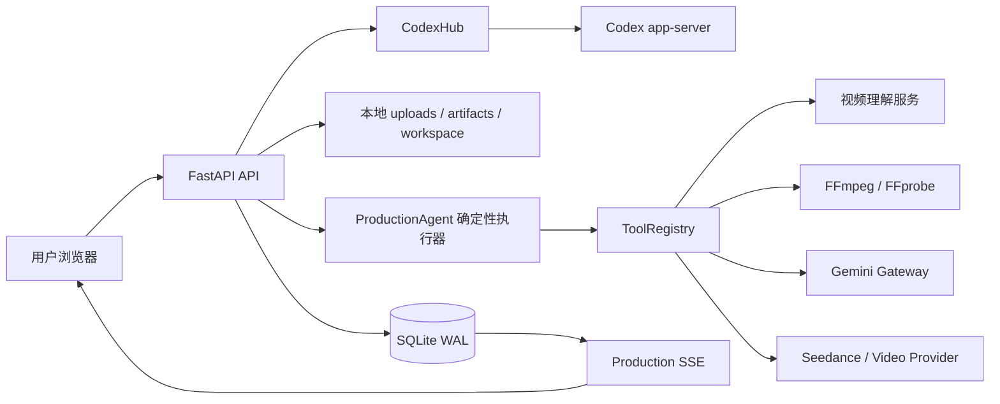
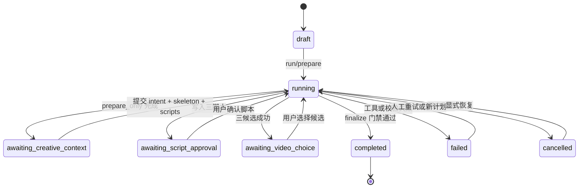
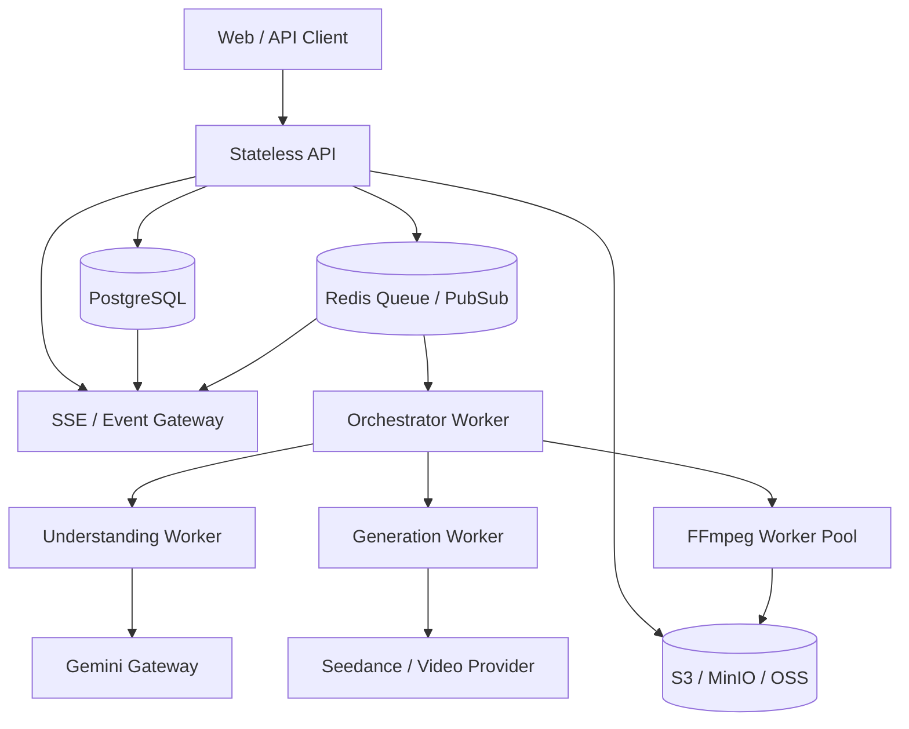

# Video Fission 视频全链路技术方案

> 代码基线：`729d5d8`（2026-11-19）
>
> 文档范围：参考视频上传、理解拆解、创意与脚本、三候选视频生成、用户选片、最终合成、字幕、异步事件与运维治理
>
> 设计原则：以当前代码为事实基线，明确区分“已实现能力”和“生产化建议”

## 0. 原片重排实施状态

项目已增加独立的原片重排快捷能力，而不是把它并入现有 AI 二创脚本流程：

- 任务类型为 `reference_remix`，旧任务默认保持 `creative`。
- 快捷入口只在用户已经上传参考视频时显示，不经过 Agent 和 `ToolRegistry`。
- Gemini 可用于原片片段理解；模型不可用时允许本地拆解，并明确写入警告。
- 开头 `[0, opening_end)` 和结尾 `[ending_start, duration)` 固定，中间片段按确定性顺序重排。
- 只生成一条成片，不创建候选视频，也不进入 `awaiting_video_choice`。
- 最终合成只调用本地 FFmpeg，不调用 Seedance 或其他视频生成模型。
- 独立 API 位于 `/api/remixes`，旧 `/api/productions` 继续只处理 `creative` 任务。

## 1. 方案摘要

Video Fission 当前是一条以 AI 模型为生产能力、以确定性状态机为控制面的短视频二创链路。

核心流程如下：

```text
参考视频上传
  -> 媒体探测与入库
  -> 转场检测、Gemini 整片理解、片段切分、开头连续块锁定、深度观察
  -> 落地页卖点提取与参考脚本检索
  -> Gemini 生成意图、骨架和 3 个候选脚本
  -> 用户确认脚本
  -> 三个候选分别生成视频、合成、混入参考 BGM
  -> 用户选择一条候选视频
  -> 最终合成、字幕样式提取、SRT 生成、硬烧字幕
  -> 下载成片
```

当前实现的关键设计判断：

1. 当前对话负责创意理解和必要的脚本兜底，后台 `ProductionAgent` 只执行本地确定性计划，不启动第二个 Codex 进程。
2. 脚本必须锁定在原视频时间轴上。模型只能改画面、口播、屏幕文字和生成提示词，不能改镜头数量、时长、顺序、复用动作和源片段 ID。
3. 脚本确认和候选视频选择是两个明确的人机门禁。用户未确认脚本时不得调用视频模型，用户未选择视频时不得完成最终合成。
4. 三个候选必须全部生成成功，任务才进入 `awaiting_video_choice`。
5. 生成镜头只允许走真实远端视频模型。模型失败时不允许本地关键帧伪生成，不允许使用“已还原参考”等误导性表述。
6. 无模型能力时可做诚实降级。视频理解可退化为本地切分并明确告警，但不得把本地规则描述成模型理解结果。
7. 使用作业幂等键、媒体探测、解码校验、精确帧数归一化和最终作业门禁，保证可重试且不把旧成片误认为本次结果。

当前版本适合单机或小规模内部部署。要达到稳定多租户生产，需要把进程内线程执行、本地文件和 JSON 大字段升级为外部任务队列、对象存储、规范化元数据和独立媒体 Worker。

## 2. 目标与边界

### 2.1 业务目标

- 用户上传一条参考视频和创作说明，系统产出三条不同创意角度的候选成片。
- 候选视频的镜头结构、长度和开场连续块继承参考视频骨架。
- 最终视频支持模型生成口播、音乐和环境音，并可复用参考视频片段。
- 用户可以明确确认脚本、选择候选视频、取消任务、查看进度和下载成片。
- 所有失败都要可诊断、可重试、可恢复，且不能以旧文件或降级结果冒充成功。

### 2.2 技术目标

- 单条任务有稳定状态机、明确阶段和可重放事件。
- 每次模型调用和媒体处理都有可追踪的输入、输出、耗时和错误。
- 相同业务输入重复执行时，不重复提交已完成的昂贵模型任务。
- 用户上传、素材、产物和敏感配置严格隔离。
- 单机模式可运行，后续可平滑演进到多实例 Worker 架构。

### 2.3 非目标

- 不做通用非线性剪辑器。
- 不保证逐像素复刻参考视频。
- 不承诺纯文本模型能够理解超过输入预算的长视频。
- 不在本方案中替换 Seedance 或 Gemini，只定义适配边界和治理方式。
- 当前版本不提供多机协同调度、跨区域灾备和主动内容风控平台。

## 3. 当前系统架构

### 3.1 逻辑架构



### 3.2 组件职责

| 组件 | 主要职责 | 代码入口 |
| --- | --- | --- |
| Vue 工作台 | 上传、对话、进度卡、脚本确认、候选视频选择、播放与下载 | `frontend/src/App.vue`、`frontend/src/components/Video*.vue` |
| FastAPI 路由 | 认证、上传、任务 API、SSE、产物下载 | `backend/video_fission/api/routes.py` |
| ProductionService | 创建、运行、暂停、选片、取消、恢复和产物公开视图 | `backend/video_fission/productions.py` |
| ProductionAgent | 本地计划、工具顺序执行、门禁和完成校验 | `backend/video_fission/production_agent.py` |
| ProductionToolHost | 细粒度生产工具实现 | `backend/video_fission/production_tools.py` |
| PipelineEngine | 媒体阶段实现和 FFmpeg 编排 | `backend/video_fission/pipeline.py` |
| Understand Service | 转场、整片理解、时间轴修复、切片段、关键帧和深度观察 | `backend/video_fission/understand/service.py` |
| Creative Generation | 基于 Gemini 生成意图、骨架和三个脚本候选 | `backend/video_fission/creative_generation.py` |
| Providers | Gemini 对话、Seedance、OpenAI Compatible、Generic HTTP | `backend/video_fission/providers.py` |
| SettingsStore | 模型端点、密钥、理解和生成参数 | `backend/video_fission/settings_store.py` |
| Database | SQLite 元数据、用户、任务、作业和事件 | `backend/video_fission/db.py` |

### 3.3 单机运行拓扑

```text
浏览器
  |
  +-- Vue 静态资源 / FastAPI :5174 或 :8000
        |
        +-- SQLite WAL: data/video_fission.db
        +-- 本地媒体: data/uploads、data/artifacts
        +-- Codex workspace: data/workspace/users/u_<hash>
        +-- Gemini Gateway
        +-- Seedance Provider
        +-- 本机 FFmpeg / FFprobe
```

单机模式依赖：

- Python 3.11+
- Node.js 20+
- `ffmpeg`、`ffprobe`
- 可选 `demucs`
- 已登录 Codex CLI，仅对话和创意兜底需要
- Gemini Gateway 与 Seedance 的有效凭证

## 4. 端到端业务流程

### 4.1 上传与任务创建

参考视频上传入口：

```http
POST /api/productions/uploads
Content-Type: multipart/form-data
```

当前约束：

- 最大 500MB。
- 扩展名支持 `mp4`、`mov`、`webm`、`m4v`、`qt`。
- 通过 `ffprobe` 校验视频流、时长、尺寸、帧率和音轨。
- 上传文件按用户写入 `data/uploads/users/u_<hash>/productions/`。
- 上传记录写入 `video_uploads`。

任务创建入口：

```http
POST /api/productions
```

关键字段：

| 字段 | 说明 |
| --- | --- |
| `title` | 可选任务标题 |
| `brief` | 创作说明，最长 20000 字 |
| `video_upload_id` | 参考视频上传 ID |
| `conversation_id` | 可选会话绑定 |
| `replace_policy` | 可选片段复用/重生成策略 |

任务初始状态为 `draft`，阶段为 `ingest`。

当前上传接口会在应用中收集所有文件块后再调用服务层，最大 500MB 文件可能占用较高内存。生产化建议见第 15 节“流式上传与对象存储”。

### 4.2 准备阶段

当前对话调用：

```text
prepare_video_production
```

执行顺序：

```text
ingest_reference_video
  -> understand_reference_video
  -> extract_landing_points
  -> search_video_references
```

准备完成后：

- 任务状态通常进入 `awaiting_creative_context`。
- `creative-context.json` 和 `timeline-summary.md` 写入用户工作区。
- `prepare_video_production` 会优先尝试 Gemini 直接生成创意。
- Gemini 成功时，任务进入 `awaiting_script_approval`。
- Gemini 不可用时，当前对话读取落盘上下文并生成三个脚本候选。

### 4.3 接入参考视频

`ingest_reference_video` 执行：

1. 检查源文件存在。
2. 将源视频复制到生产产物目录。
3. 使用 `ffprobe` 重新探测实际媒体属性。
4. 更新 `source_video.duration_ms`、`width`、`height`、`fps`。

任务后续所有切片段、时间轴和输出规格以接入后的探测结果为准。

### 4.4 视频理解与拆解

#### 4.4.1 转场检测

默认开启 `transition_detection`，检测顺序：

1. PySceneDetect 获取传统场景分数。
2. TransNetV2 提供 CNN 转场分数。
3. 两路分数融合生成切点。
4. 转场检测不可用时退化为 FFmpeg 场景切分。
5. 检测失败必须写入 warning 和事件，不能静默降级。

可用配置：

- `transition_detection`: 是否启用。
- `clip_workers`: 深度观察并发数，范围 1 到 8。
- `gemini_max_size_mb`: 模型输入视频大小上限，默认 15MB。
- `observe`: 是否执行逐片段深度观察。
- `observe_timeout_seconds`: 单片段观察超时，默认 360 秒。

#### 4.4.2 本地时间轴基线

系统先根据转场、静音点和时长生成 Hook / Value / CTA 本地基线：

- 开场目标窗口约为全片 15%，限制在 1.5 到 3 秒。
- 结尾目标窗口约为最后 3 秒。
- 中段最多拆 8 个价值片段。
- 优先吸附到静音句界，其次场景切点，再次按目标位置切分。
- 短片段和小缺口做合法化处理。

这个本地基线用于覆盖校验和模型失败兜底，不代表模型理解结果。

#### 4.4.3 Gemini 整片理解

模型输入选择策略：

1. 估算视频 token：约 `85 token/s + 256`。
2. 估算提示词 token。
3. 在输入预算内优先发送完整视频和完整提示词。
4. 预算不足时改用精简提示词。
5. 仍超预算时抽取关键帧。
6. 视频文件超过 `gemini_max_size_mb` 时先压缩。

Gemini 请求失败时：

- 非降级模式下整个拆解失败。
- 允许本地兜底时保留本地切分，并明确写入 warning。
- 每一次 Gemini 理解响应都会记录到 `gemini_api_calls/video_understanding/`。

#### 4.4.4 模型输出校验

模型返回镜头必须通过以下处理：

1. 时间解析兼容秒、毫秒、`mm:ss`、`hh:mm:ss`。
2. 片段按开始时间排序。
3. 修复重叠和空隙。
4. 首段从 0 开始，末段到全片结束。
5. 校验全片覆盖率。
6. 使用转场检测帧级精修边界。
7. 覆盖失败时回退本地切分。
8. 模型提供的 ID 不作为路径，系统重新生成 `seg_01`、`seg_02` 等 ID。

#### 4.4.5 开场连续块

开场是一个不可再切分的连续块：

- 范围固定为 `[0, opening_end)`。
- `opening_end` 优先来自模型。
- 只在模型时间点前后 600ms 内吸附一次。
- 吸附优先级为静音句界、场景切点、片段边界。
- 模型没有给出有效开头时使用本地暂估，并明确标记 `local_fallback`。
- 后续脚本必须正好包含一个 `shot_opening`，时长必须等于 `opening_end`。

这样可以避免模型另行生成 3 秒 hook 切点，破坏原片开头连续性。

#### 4.4.6 切片、关键帧和深度观察

每个片段执行：

1. 从源视频切出 `clips/seg_XX.mp4`。
2. 抽取 3 张关键帧，通常位于片段 15%、50%、82% 位置。
3. 单独切出 `clips/opening.mp4`。

深度观察按片段并发执行，结果只保留链路实际消费的信息：

- 画面主体
- 画面动作
- 场景与道具
- 机位观察
- 画面文字
- 信息呈现方式
- 口播转写
- 音轨观察
- 序列作用
- 主张表达
- 不确定性说明

观察使用视频优先、关键帧兜底。没有音轨时不允许编造口播；无法确认时写入不确定性说明。

### 4.5 落地页与参考脚本

`extract_landing_points` 从 brief 中识别 URL 或粘贴正文：

- 成功时提取产品、受众、卖点、利益、承诺等结构化信息。
- 部分成功时写入 `partial`，不能当作完整事实。
- 抓取失败时写入 warning，但不阻塞已有素材继续出片。
- 无 URL 或无正文时仍可凭参考视频和 brief 继续。

`search_video_references` 检索内置 `video-references`：

- 先按品类和关键词猜测主类目。
- 同品类最多取 3 篇。
- 跨品类最多补 1 篇结构参考。
- 返回路径、检索原因和首行骨架。
- 完整脚本由当前对话通过受控 `read_skill` 读取。

### 4.6 创意意图与三脚本生成

#### 4.6.1 Gemini 主路径

`generate_creative_bundle` 将以下真实上下文压缩后发给 Gemini：

- 创作说明
- 源视频信息
- 开场区间
- 片段摘要、视觉、观察卡
- 落地页结构化信息
- 检索到的参考脚本路径和原因
- 用户参考图元数据

要求模型输出：

```json
{
  "intent": {
    "goal": "目标",
    "true_intent": "真实意图",
    "audience": "受众",
    "selling_points": ["卖点"],
    "pain_points": ["痛点"],
    "promise": "核心承诺",
    "evidence": ["证据"],
    "assumptions": ["假设"]
  },
  "skeleton": {
    "one_liner": "一句话骨架",
    "hook": "开场",
    "value": "价值",
    "cta": "行动"
  },
  "candidates": [
    {
      "id": "script_a",
      "title": "痛点切入",
      "angle": "方案角度",
      "script": {
        "shots": []
      }
    }
  ]
}
```

后端强制候选 ID 为：

- `script_a`: 痛点切入
- `script_b`: 效果利益
- `script_c`: 信任促单

模型只能提供镜头文案字段。以下字段由后端时间轴锁定：

- 镜头数量
- 镜头顺序
- `start_ms`
- `end_ms`
- `duration_ms`
- `role`
- `action`
- `source_segment_id`
- `id`
- 开场块结构

#### 4.6.2 当前对话兜底

Gemini 不可用时：

1. 当前对话读取 `creative-context.json` 或 `timeline-summary.md`。
2. 按 Skill 要求生成 `intent`、`skeleton` 和恰好三个 `script_candidates`。
3. 调用 `run_video_production`，通常设置 `resume_from=script`。
4. 后台重写时间轴并停在 `awaiting_script_approval`。

#### 4.6.3 脚本门禁

`write_intent_and_scripts` 必须校验：

- 恰好三个候选。
- 三个候选 ID 非空且互不重复。
- 每个候选经过严格时间轴锁定。
- 开场仍是一个连续的 `shot_opening`。
- 写入后 `selected_script_id` 为空。
- 写入后 `candidate_videos` 清空。
- 状态置为 `awaiting_script_approval`。

用户明确确认后，`approve_scripts` 才会以 `resume_from=generate` 和 `user_approved=true` 启动视频生成。

#### 4.6.4 片段复用与重生成策略

脚本动作由 `replace_policy`、brief 和开场块规则共同决定。用户和模型都不能直接改写最终动作。

| 模式 | 行为 |
| --- | --- |
| `default` | 未点名片段时，非开场的 Hook/CTA 生成，中段 Value 默认复用 |
| `all` | 所有可生成片段都生成新视频 |
| `selected` | 只生成 `segment_ids`、`roles` 或 `time_ranges` 命中的片段 |
| `brief` | 从 brief 中解析“第几段”“开场/结尾”“几秒到几秒”等目标 |

默认规则还需要遵守开场块不变量：

- 开场块默认复用为单个连续 `shot_opening`。
- 只有用户明确点名开场内片段、选择 `all` 或明确要求全部生成时，整个开场块才改为生成。
- 不能只生成开场块中的某一个子片段。
- `selected` 模式未命中任何片段时，`/run` 直接返回 400，不启动后台任务。
- 解析后的 `replace_plan` 会落库，后续生成以该计划为准。

brief 还支持“全部新生成”“尽量复用原片”等整体意图。“尽量复用原片”只会让非开场的
Value 段复用，非开场 Hook/CTA 仍按默认生成；开场块仍遵守连续块复用规则。解析时会去掉
重生成指令本身，避免把“把第二段重新生成”误当成需要烧进视频的文案。

### 4.7 三候选视频生成

当前执行器为每个候选顺序执行：

```text
选择候选脚本
  -> 生成或复用每个镜头
  -> 逐镜头媒体校验
  -> 合成当前候选
  -> 记录 candidate_video_completed
```

三条候选全部完成后：

- `candidate_videos` 恰好三条。
- 状态进入 `awaiting_video_choice`。
- `selected_script_id` 重置为空。
- 后续必须由用户选择一条候选。

当前实现是“候选串行、镜头串行”。优点是实现简单、资源峰值低；缺点是总时长接近所有镜头生成时间之和。生产化改造见第 15 节。

### 4.8 单镜头生成规则

每个脚本镜头只有两种动作：

| 动作 | 行为 |
| --- | --- |
| `reuse` | 从参考视频指定区间裁切并标准化 |
| `generate` | 调用远端视频模型生成新镜头 |

生成镜头前置校验：

- Provider 只能是 `seedance`、`openai_compatible` 或 `generic_http`。
- 存在生成镜头时必须配置 `base_url`。
- 存在生成镜头时必须存在 API Key 或 runtime fallback 凭证。
- 不允许 `local_ffmpeg` 生成视频。

提示词由以下部分组成：

- 镜头视觉描述或脚本 prompt。
- 口播原文。
- 明确要求模型直接生成同步语音和音乐/环境音。
- 明确要求画面内不得生成字幕、标题、花字和说明文字。
- 落地页卖点上下文。
- 时长调整说明。
- 最多三张用户参考图作为 `reference_image`。

参考视频本身当前不会上传给 Seedance。它只用于本地理解、片段复用和脚本生成。

Seedance 调用协议：

```text
POST /acore/model/v1/task/generate/video
GET  /acore/model/v1/task/video/{taskId}
```

关键兼容规则：

- `seedance-2.0-flash` 映射为 `seedance-2-0-fast`。
- 单次时长只支持 4 到 15 秒整数。
- 请求时长不足 4 秒时按 4 秒提交，再本地裁到目标时长。
- 请求时长超过 15 秒时按 15 秒提交，再本地补齐到目标时长。
- 默认 720p、无水印、生成音频、不返回尾帧。
- 远端任务 ID 写入 `production_jobs.external_task_id`。
- 重启恢复时只轮询已存在任务，不重复提交。

其他视频 Provider 的协议边界：

| Provider | 提交地址 | 响应类型 |
| --- | --- | --- |
| `openai_compatible` | `{base_url}/video/generations` | 原始视频、视频 URL 或 `job_id` |
| `generic_http` | `POST {base_url}` | 原始视频、视频 URL 或 `job_id` |

通用请求体至少包含：

```json
{
  "model": "provider-model",
  "prompt": "单镜头提示词",
  "duration_ms": 2800,
  "width": 1080,
  "height": 1920,
  "fps": 30
}
```

Seedance 的宽高比根据目标尺寸映射为横屏或竖屏。项目默认请求 720p，可由设置改为 480p。所有远端结果最终仍要经过本地标准化和音轨校验。

### 4.9 媒体验证与标准化

每个镜头生成完成后执行：

1. 文件存在且大于最小体积。
2. `ffprobe` 能解析。
3. 时长误差不超过 150ms。
4. 生成镜头必须带音轨。
5. 复用镜头无音轨时补静音轨。
6. 解码全量主音视频流。
7. 转码为统一视频规格。

统一媒体规格：

- 视频编码：H.264 / `libx264`
- 像素格式：`yuv420p`
- 色彩范围：TV
- 色彩空间：BT.709
- SAR：1:1
- 音频编码：AAC
- 声道：双声道
- 采样率：44100Hz
- 长边最大 1920，宽高保持偶数
- 非目标宽高比通过等比缩放和补边处理
- 精确到目标帧数和目标时长

### 4.10 音频分离与 BGM

`separate_audio` 优先使用 Demucs：

- `vocals.wav` 转为 `reference-vocals.m4a`
- `no_vocals.wav` 或 `accompaniment.wav` 转为 `reference-bgm.m4a`

Demucs 不可用或失败时：

- 双声道使用中置/侧边近似。
- 单声道使用互补频段。
- 显式标记 `local_ms` 或 `placeholder`。
- 无音轨时写空占位，`usable=false`。
- 不允许把人声和 BGM 产物相同或与原混音相同的情况标记为成功。

合成时，参考 BGM 默认以 `0.12` 音量混入镜头原音。混入失败保留镜头原音并写 warning。

### 4.11 候选合成与最终合成

候选合成执行：

1. 按脚本镜头顺序取片段。
2. 镜头动作切换边界可加短淡化。
3. 使用 FFmpeg concat 拼接。
4. 可选混入参考 BGM。
5. 音视频精确对齐到脚本总时长。
6. 成功后复制为候选专属 `composed-{job_id}.mp4`。

用户选片后：

1. `select_video` 只允许当前任务已生成的三条候选之一。
2. 将被选候选的脚本、片段和中间成片写回生产任务。
3. 从 `finalize` 恢复。
4. 再次执行 `compose_timeline`，生成最终合成文件。
5. 执行 `burn_subtitles`。

最终完成门禁必须满足：

- 计划中的合成和字幕步骤全部成功。
- 最终文件存在且非空。
- `burn_subtitles` 的输出版本与本任务成功作业一致。
- 最终文件不是历史旧成片。
- 所有关联作业都不是失败或未完成状态。

### 4.12 字幕

字幕流程：

1. 检查参考视频是否含软字幕。
2. 有 ASS 时解析字体、字号、颜色、对齐和边距。
3. 只有成功读取并使用参考样式时标记 `aligned=true`。
4. 无软字幕或无法解析时使用安全默认样式。
5. 按脚本镜头口播和时长生成 `final.srt`。
6. 将 SRT 转为 ASS，并硬烧到视频。
7. 默认安全样式不得描述为“按参考对齐”。

### 4.13 追问与恢复

同一 `production_id` 内的追问由 `handle_production_followup` 分类：

- 候选视频选择：进入 `finalize`。
- 脚本修改：回到 `script` 或 `intent`。
- 新卖点或新落地页：回到 `intent`。
- 含糊表达如“再改一下”：请求澄清，不重跑整条链路。
- 已选脚本但要求再生成：从 `generate` 恢复。

服务重启时：

- `status=running` 的任务被识别为孤立任务。
- 有成功外呼任务 ID 的作业保留 ID，只恢复轮询。
- 没有远端 ID 的 running 作业回到 pending。
- `agent_trace` 中最近一次 plan 和连续成功步骤用于恢复。
- 恢复要求成功步骤是计划前缀，否则安全失败，不猜执行位置。

## 5. 状态机

### 5.1 任务状态

| 状态 | 含义 |
| --- | --- |
| `draft` | 已创建，尚未运行 |
| `running` | 后台执行器正在执行 |
| `awaiting_creative_context` | 拆解和检索完成，等待意图与脚本 |
| `awaiting_script_approval` | 三份脚本已写入，等待用户确认 |
| `awaiting_video_choice` | 三条候选全部生成，等待用户选片 |
| `completed` | 最终成片和字幕成功 |
| `failed` | 当前计划失败 |
| `cancelled` | 用户取消 |
| `awaiting_script_choice` | 旧版本兼容状态，只用于恢复迁移 |

### 5.2 阶段

```text
ingest -> decompose -> intent -> script -> generate -> compose -> done
```

注意：

- `finalize` 是恢复入口，不是新阶段；对应 `current_stage=compose`。
- `intent` 阶段承载落地页、参考脚本、意图和骨架。
- `script` 阶段承载三脚本锁定和用户确认。
- `generate` 阶段承载三候选逐镜头生成和候选合成。
- `compose` 阶段承载最终合成和字幕。

### 5.3 状态迁移



### 5.4 恢复入口

`POST /api/productions/{id}/run` 支持：

| `resume_from` | 用途 |
| --- | --- |
| `ingest` | 重新接入源视频 |
| `decompose` | 重新理解和拆解 |
| `intent` | 重做落地页、参考检索和时间轴 |
| `script` | 重写脚本，仍停在确认门禁 |
| `generate` | 生成三条候选，必须已有三脚本和用户确认 |
| `finalize` | 对已选候选做最终合成和字幕 |

省略 `resume_from` 时，服务根据已有产物和跟进内容判断恢复点。

## 6. 核心数据结构

### 6.1 拆解结果

```json
{
  "summary": "整片摘要",
  "description": "整片描述",
  "provider": "gemini_gateway",
  "model": "gemini-3.8-flash",
  "video_tags": {
    "product_name": [],
    "video_summary": "整片摘要",
    "video_describe": "整片描述"
  },
  "opening": {
    "start_ms": 0,
    "end_ms": 4200,
    "method": "model",
    "reason": "开场信息完整，在句末结束",
    "segment_ids": ["seg_01", "seg_02"],
    "clip_path": "clips/opening.mp4",
    "clip_url": "/api/productions/prd_xxx/artifacts/clips/opening.mp4"
  },
  "segments": [
    {
      "id": "seg_01",
      "role": "hook",
      "start_ms": 0,
      "end_ms": 2300,
      "summary": "痛点开场",
      "description": "人物在雪地展示车窗结霜",
      "visual": "近景车窗和手持设备",
      "audio": "现场环境声",
      "on_screen_text": "车窗结冰怎么办",
      "reuse_recommended": false,
      "slot": ["开场钩子"],
      "sub_slot": [],
      "sub_slot_desc": [],
      "clip_path": "clips/seg_01.mp4",
      "clip_url": "/api/productions/prd_xxx/artifacts/clips/seg_01.mp4",
      "observe": {
        "shot_observation_card": [],
        "raw_claims": [],
        "speech_evidence": {}
      }
    }
  ]
}
```

### 6.2 脚本镜头

```json
{
  "id": "shot_02",
  "role": "value",
  "duration_ms": 2800,
  "action": "reuse",
  "source_segment_id": "seg_02",
  "visual": "展示设备出风口和雪雾",
  "voiceover": "大面积积雪也能快速吹开",
  "on_screen_text": "快速除雪",
  "prompt": ""
}
```

生成镜头示例：

```json
{
  "id": "shot_03",
  "role": "cta",
  "duration_ms": 2400,
  "action": "generate",
  "source_segment_id": "seg_04",
  "visual": "手持设备对准木屋台阶，镜头缓慢推进",
  "voiceover": "冬季常备，出行前先清一遍",
  "on_screen_text": "冬季常备",
  "prompt": "真实产品广告风格，手持设备清洁木屋台阶积雪，镜头缓慢推进，动作自然，无文字"
}
```

### 6.3 脚本候选

```json
{
  "id": "script_a",
  "title": "痛点切入",
  "angle": "先还原用户被积雪和结霜卡住的场景",
  "script": {
    "total_duration_ms": 12000,
    "opening": {
      "start_ms": 0,
      "end_ms": 4200,
      "shot_id": "shot_opening"
    },
    "shots": [],
    "audio_plan": {
      "voiceover_language": "zh",
      "bgm": "model_generated",
      "subtitles": false
    }
  }
}
```

### 6.4 候选视频

```json
{
  "id": "script_a",
  "script_id": "script_a",
  "title": "痛点切入",
  "angle": "痛点先行的结构",
  "status": "ready",
  "clips": [],
  "output": {
    "video_path": "/abs/.../composed-job_xxx.mp4",
    "video_url": "/api/productions/prd_xxx/artifacts/composed-job_xxx.mp4"
  },
  "video_url": "/api/productions/prd_xxx/artifacts/composed-job_xxx.mp4",
  "duration_ms": 12000,
  "width": 1080,
  "height": 1920
}
```

公开 API 只在候选数量正好为三时展示候选列表，避免暴露半成品。

### 6.5 当前持久化模型

`productions` 表采用宽表加 JSON 字段：

- `source_video`
- `decomposition`
- `intent`
- `skeleton`
- `script`
- `script_candidates`
- `candidate_videos`
- `clips`
- `output`
- `replace_policy`
- `replace_plan`
- `reference_images`
- `landing_page`
- `audio_separation`
- `subtitle_style`
- `agent_trace`

优点是开发快、结构弹性高。缺点是难以按镜头查询、统计、并发更新和做细粒度索引。

## 7. API 与事件契约

### 7.1 主要接口

| 方法 | 路径 | 是否同步 | 说明 |
| --- | --- | --- | --- |
| `POST` | `/api/productions/uploads` | 同步 | 上传参考视频 |
| `POST` | `/api/productions` | 同步 | 创建任务 |
| `POST` | `/api/productions/{id}/run` | 异步启动 | 启动或恢复任务 |
| `POST` | `/api/productions/{id}/generate-scripts` | 同步 | 强制 Gemini 生成脚本 |
| `POST` | `/api/productions/{id}/approve-scripts` | 异步启动 | 确认脚本并生成候选 |
| `POST` | `/api/productions/{id}/select-video` | 异步启动 | 选择候选并做最终合成 |
| `POST` | `/api/productions/{id}/cancel` | 同步 | 取消任务 |
| `GET` | `/api/productions/{id}/events` | SSE | 增量拉取进度事件 |
| `GET` | `/api/productions/{id}/artifacts/{name}` | 同步 | 下载产物 |

除认证、健康检查等入口外，接口要求登录。已知任务 ID 也要通过用户所有权校验，否则返回 404。

### 7.2 SSE 协议

请求：

```http
GET /api/productions/prd_xxx/events?after_id=123
```

响应格式：

```text
id: 124
data: {"id":124,"type":"stage_started","payload":{...},"created_at":"..."}

: heartbeat 1760000000
```

客户端使用 `after_id` 断线重连。服务端每 0.45 秒读取新事件，每 12 秒发送心跳。任务进入 `completed`、`failed` 或 `cancelled` 且无剩余事件时关闭流。

主要事件：

| 事件 | 说明 |
| --- | --- |
| `agent_plan` | 本地执行计划和加载的 Skill |
| `skill_loaded` | 完成一次 Skill 装载记录 |
| `tool_started` | 工具开始 |
| `tool_completed` | 工具完成 |
| `stage_started` | 媒体阶段开始 |
| `stage_completed` | 媒体阶段完成 |
| `warning` | 非致命降级或质量风险 |
| `progress` | 候选生成等长任务进度 |
| `candidate_video_completed` | 单条候选完成 |
| `awaiting_script_approval` | 脚本门禁 |
| `awaiting_video_choice` | 选片门禁 |
| `completed` | 最终完成 |
| `error` | 任务失败 |

## 8. 持久化、幂等与恢复

### 8.1 SQLite 配置

- 默认启用 WAL，适合单机读多写少和 SSE 轮询。
- 任务、事件、作业和配置在一个数据库内，便于故障恢复。
- API 与后台线程通过事务更新状态。

### 8.2 production_jobs

关键字段：

| 字段 | 说明 |
| --- | --- |
| `tool` | 生成、合成、字幕等作业类型 |
| `shot_id` | 生成作业关联镜头 |
| `idempotency_key` | 业务输入摘要，唯一 |
| `status` | `pending/running/succeeded/failed/cancelled` |
| `external_task_id` | Seedance 等远端任务 ID |
| `attempt_count` | 执行次数 |
| `input_json` | 不包含密钥的作业输入 |
| `result_json` | 作业结果和产物路径 |
| `started_at` / `finished_at` | 运行时间 |

### 8.3 幂等策略

当前生成作业幂等键由以下内容摘要构成：

```text
production_id + tool + shot_id + input_json
```

生产任务 revision 由以下内容摘要构成：

- `selected_script_id`
- `script`
- `source_video`
- `replace_plan`

已成功且产物仍有效的作业可以直接复用。失败作业可用同一幂等键重试。

目标生产架构建议把幂等键扩展到：

```text
production_id
script_id
shot_id
prompt_sha256
source_segment_id
provider
model
duration_ms
width
height
fps
```

这样即使同一镜头重试，也能区分“提示词变化”和“纯网络重试”。

### 8.4 取消语义

当前取消行为：

- 设置本地 cancel event。
- 任务状态置为 `cancelled`。
- 所有 pending/running 作业本地置为 cancelled。
- Seedance 没有可用取消接口，远端任务可能继续执行。
- 迟到的远端结果不能覆盖 cancelled job 状态，但可保留 `external_task_id` 便于诊断。

目标架构应在 Provider 支持时增加远端取消，并在 API 结果中返回远端取消状态。

## 9. 生产化目标架构

### 9.1 目标拓扑



### 9.2 服务拆分

| 服务 | 职责 | 扩容依据 |
| --- | --- | --- |
| API | 认证、上传协调、任务命令、查询、SSE | QPS |
| Orchestrator | DAG 推进、门禁、状态迁移 | 活跃任务数 |
| Understanding Worker | 转场、Gemini、观察 | 视频分钟数 |
| Generation Worker | 视频模型提交和轮询 | 模型并发配额 |
| Media Worker | 切片、归一化、拼接、混音、字幕 | CPU 和 FFmpeg 并发 |
| Event Gateway | 持久事件、推送和重连 | SSE 连接数 |

### 9.3 DAG 拆分

目标 DAG：

```text
ingest
  -> decompose
  -> creative
  -> script_gate
  -> fan_out over script_a / script_b / script_c
       -> fan_out over shots
       -> candidate compose
  -> video_choice_gate
  -> final compose
  -> subtitle burn
  -> quality check
  -> completed
```

并发控制建议：

- 每用户最大活跃生产任务数可配置。
- 每 Provider 设置全局并发和速率限制。
- 同一候选内最多并行 N 个镜头，默认 3。
- 三条候选中最多并行 M 条，默认 2 或 3。
- FFmpeg 任务独立限流，避免与模型轮询争抢资源。
- 对 429、5xx 和超时使用指数退避。

### 9.4 对象存储

建议对象键：

```text
prod/{production_id}/
  source/reference.mp4
  understanding/clips/seg_01.mp4
  understanding/frames/seg_01_01.jpg
  candidates/script_a/shots/shot_02/raw.mp4
  candidates/script_a/shots/shot_02/normalized.mp4
  candidates/script_a/composed.mp4
  final/composed.mp4
  final/final.mp4
  final/final.srt
  diagnostics/gemini/
```

上传建议改为预签名直传：

1. 客户端向 API 申请上传会话。
2. API 返回短期预签名 PUT URL。
3. 客户端直接上传到对象存储。
4. 客户端提交完成回调。
5. API 对对象执行 `ffprobe`、哈希和大小校验。

这样可以消除 500MB 文件进入 API 进程内存的问题。

### 9.5 数据库规范化

建议新增或拆分：

| 表 | 用途 |
| --- | --- |
| `production_assets` | 素材、哈希、对象键、媒体元数据 |
| `production_segments` | 拆解片段、时间范围、角色、观察结果 |
| `production_scripts` | 候选脚本、意图、骨架、版本 |
| `production_shots` | 镜头级状态、动作、Provider、调用参数 |
| `production_candidates` | 候选视频、选片状态、合成产物 |
| `production_jobs_v2` | DAG 作业、依赖、租约、重试、优先级 |
| `production_events_v2` | 可分区、可归档的事件流 |

`productions` 保留任务主状态和用户可见摘要，不再承载无限增长的 JSON。

### 9.6 事件与实时进度

推荐同时使用：

- 数据库持久事件，作为事实来源。
- Redis Pub/Sub 或消息总线，作为低延迟通知。
- SSE 服务从持久事件补发断线期间的数据。

客户端事件至少包含：

- `event_id`
- `production_id`
- `event_type`
- `stage`
- `job_id`
- `progress`
- `attempt`
- `occurred_at`
- `payload`

## 10. 模型与媒体治理

### 10.1 Provider 适配层

建议把当前函数式 Provider 封装为统一接口：

```python
class VideoProvider:
    def submit(self, request: VideoRequest) -> ProviderTask: ...
    def poll(self, task_id: str) -> ProviderTask: ...
    def download(self, task: ProviderTask, dest: Path) -> Path: ...
    def cancel(self, task_id: str) -> bool: ...
```

统一治理：

- 超时
- 重试
- 速率限制
- 熔断
- 请求 ID
- 幂等键
- 成本记录
- Provider 原始响应归档
- 密钥脱敏

### 10.2 模型调用记录

至少记录：

- Provider
- 模型
- 端点
- 输入模式：video、frames、text
- 提示词长度或哈希
- 输入 token 估算
- 输出 token 使用量
- 请求耗时
- 状态码
- 错误类型
- Provider task ID
- 费用

默认不记录完整提示词和完整响应。需要排障时通过显式开关临时开启截断预览。

### 10.3 质量门禁

当前已有基础门禁：

- 文件存在和非空。
- 媒体可解析。
- 时长误差。
- 生成镜头有音轨。
- 全量解码。
- 最终作业关联校验。

生产化建议增加：

- 黑帧检测
- 冻结帧检测
- 响度检测
- 静音比例检测
- 画面文字泄漏检测
- 商品主体一致性检查
- 卖点事实核对
- 参考视频复用片段版权和合规标记
- 生成内容安全审核

质量检查失败应支持：

- 自动重试当前镜头
- 标记候选不可选
- 降级为人工审核
- 全任务失败

## 11. 安全与用户隔离

### 11.1 认证

- 本地账号密码登录。
- JWT 存在 HttpOnly Cookie，也兼容 Bearer。
- 企业 CAS SSO 可选。
- 密码修改后 `token_version` 变化，旧令牌失效。

### 11.2 所有权

- 会话、上传、生产任务、事件和产物都按 `user_id` 校验。
- 对无权访问的已知 ID 返回 404，避免枚举。
- Skill 和 Tool 配置为全局能力。

### 11.3 文件安全

- 产物文件名拒绝绝对路径和 `..`。
- 服务端生成的片段 ID 不信任模型输出。
- 参考库路径必须位于 Skill 根目录内。
- 上传文件先探测再入库。
- 下载响应按扩展名设置媒体类型。

### 11.4 密钥安全

- API Key 只写不回显。
- 设置接口只返回 `api_key_set`。
- 作业 `input_json` 不包含密钥。
- 日志必须对 URL query、data URL 和凭证脱敏。
- Seedance 机器级凭证可来自环境变量或本机 `~/.acore/auth.json`，不自动复制进数据库。

### 11.5 浏览器安全

- 非只读 API 校验 Origin。
- 响应设置 `nosniff`、`no-referrer`、`DENY` 和 CSP。
- API 响应默认 `no-store`。

### 11.6 生产化补充

- 对象存储使用短期签名 URL。
- 病毒扫描和媒体沙箱。
- 上传内容安全审核。
- 用户存储配额。
- 管理操作审计日志。
- 数据保留和删除策略。

## 12. 可观测性

### 12.1 日志字段

当前日志关联字段：

- `request_id`
- `conversation_id`
- `production_id`
- `stage`
- `step`
- `provider`
- `thread`

日志覆盖：

- API 请求
- Provider 调用
- Codex RPC
- 转场和切片
- Gemini 理解
- 深度观察
- 镜头生成
- FFmpeg

日志默认同时输出到终端和 `status/video-fission.log`，单文件 20MB，保留 10 份。

### 12.2 建议指标

| 指标 | 类型 | 说明 |
| --- | --- | --- |
| `production_total` | Counter | 任务创建数 |
| `production_completed_total` | Counter | 完成数 |
| `production_failed_total` | Counter | 失败数，按阶段和错误码 |
| `production_duration_seconds` | Histogram | 端到端耗时 |
| `stage_duration_seconds` | Histogram | 阶段耗时 |
| `provider_request_total` | Counter | Provider 请求量 |
| `provider_latency_seconds` | Histogram | Provider 延迟 |
| `provider_error_total` | Counter | Provider 错误 |
| `provider_cost_total` | Counter | 模型费用 |
| `ffmpeg_duration_seconds` | Histogram | 媒体处理耗时 |
| `sse_connections` | Gauge | 当前 SSE 连接 |
| `job_queue_depth` | Gauge | 队列积压 |
| `job_retry_total` | Counter | 重试次数 |

### 12.3 建议 Trace

一条任务链路应能串起：

```text
API upload
  -> ingest
  -> Gemini split
  -> clip cut
  -> observe calls
  -> creative generation
  -> script gate
  -> video submit
  -> video poll
  -> normalize
  -> concat
  -> subtitle
```

使用 OpenTelemetry 或等价方案传播 trace context，但不要把完整提示词和用户视频内容写入 trace。

## 13. 容量与性能

### 13.1 当前耗时模型

当前候选生成近似串行：

```text
T_total =
  T_ingest
  + T_decompose
  + T_creative
  + sum(T_candidate_a, T_candidate_b, T_candidate_c)
  + T_final_compose
  + T_subtitle
```

其中：

```text
T_candidate =
  sum(T_shot_generate / T_shot_reuse)
  + T_candidate_compose
```

假设每个候选 5 个生成镜头，Provider 单镜头最长 600 秒，仅生成阶段最坏可达：

```text
3 candidates * 5 shots * 600 s = 9000 s = 150 min
```

实际耗时会受生成镜头数量、片段复用比例、Provider 排队和超时设置影响。

### 13.2 当前瓶颈

- 三候选串行。
- 单候选镜头串行。
- 单机 FFmpeg 与模型轮询共用一个进程。
- Gemini 深度观察默认并发 3，可按需升到 8。
- SQLite 适合单机，不适合多 Worker 高并发写。
- JSON 大字段使细粒度查询和统计困难。
- 上传接口存在大文件内存收集。

### 13.3 目标并发

建议先以以下参数做压测基线：

| 参数 | 建议初值 |
| --- | --- |
| 每用户活跃生产任务 | 2 |
| 每生产候选并发 | 2 |
| 每候选镜头并发 | 3 |
| Gemini 全局并发 | 6 |
| Seedance 全局并发 | 按供应商配额 |
| FFmpeg 全局并发 | `max(2, CPU物理核心数 / 2)` |
| SSE 单实例连接 | 独立压测后确定 |

建议先设定以下 SLO，再用真实 Provider 和压测数据校准：

| SLO | 建议目标 |
| --- | --- |
| `POST /run` 命令响应 | p95 小于 500ms，不等待长任务完成 |
| SSE 事件可见延迟 | p95 小于 2 秒 |
| 生产任务成功率 | 排除用户输入和 Provider 内容拒绝后大于 97% |
| 重复外呼抑制 | 同一幂等键不得重复提交已成功或已持有 external task ID 的作业 |
| 成片完整性 | 100% 通过文件存在、非空、可解码和作业关联校验 |
| 事件可恢复性 | 断线后通过 `after_id` 不丢持久化事件 |

### 13.4 存储估算

单任务可能包含：

- 1 条参考视频
- 1 组拆片段
- 1 组关键帧
- 3 条候选的镜头文件
- 3 条候选合成文件
- 1 条最终合成
- 1 条烧字幕成片
- SRT、ASS、诊断 JSON

应按“源文件大小 + 片段冗余 + 候选倍数 + 编码中间产物”估算，不能按单条参考文件大小估算。

建议：

- 免费用户任务产物保留 7 天。
- 普通用户 30 天。
- 企业用户可配置。
- 任务删除时同步删除对象和可回收缓存。
- 中间 raw 文件可优先清理。

## 14. 失败处理与降级

### 14.1 失败分类

| 类别 | 示例 | 处理 |
| --- | --- | --- |
| 输入错误 | 格式不支持、无视频流、brief 为空 | 返回 400，不创建后台作业 |
| 权限错误 | 非所有者、无会话 | 返回 404 或 403 |
| 模型失败 | 401、429、超时、响应不可解析 | 重试、熔断或诚实失败 |
| 媒体失败 | 切片失败、无音轨、解码失败 | 当前镜头失败，候选不可进入选择 |
| 状态冲突 | running、未确认脚本、未选视频 | 返回 409 |
| 磁盘失败 | 写入失败、无空间 | 当前任务失败并告警 |
| 进程中断 | 服务重启 | 从 plan 和作业恢复 |

### 14.2 降级规则

允许降级：

- 转场检测失败退化为 FFmpeg。
- Gemini 理解失败且允许兜底时保留本地切分。
- 无软字幕时使用安全默认字幕样式。
- 参考音频分离失败时保留镜头原音。
- 落地页抓取失败时继续使用其他创意上下文。

禁止降级：

- 用本地关键帧冒充视频模型生成。
- 生成镜头无音轨却标记成功。
- 没有三份脚本却进入生成。
- 没有三条候选却进入选片。
- 使用旧版 `final.mp4` 冒充本次最终产物。
- 本地或估算结果冒充模型理解结果。

## 15. 生产化改造路线

### 阶段 1：低成本性能与可靠性

目标：

- 上传改为流式落盘，避免 500MB 文件整体驻留内存。
- 三候选改为有限并发，默认每任务同时 2 条。
- 每候选镜头改为有限并发，默认 3 个。
- 增加每 Provider 和每用户并发控制。
- 增加任务级预算：最大镜头数、最大总时长、最大调用成本。
- SSE 事件增加 `progress_pct` 和 `current/total`。

验收：

- 相同输入下不产生重复远端任务。
- 并发改造后成片时长和镜头顺序不变。
- 单 Provider 限流生效。
- 进程中断后可从已有 external task ID 恢复。

### 阶段 2：外部任务队列与对象存储

目标：

- API 进程不再执行长时间 FFmpeg 和 Provider 轮询。
- 引入 Redis 或等价消息队列。
- 引入 S3 / MinIO / OSS。
- 任务作业带租约、心跳、重试上限和死信状态。
- 支持多 API 实例。

验收：

- 停止任一 Worker 不丢任务。
- 同一幂等键只有一个 Worker 持有执行租约。
- 任务可从任意节点恢复轮询。
- 产物通过短期签名 URL 下载。

### 阶段 3：元数据规范化与运营能力

目标：

- 拆分 segments、scripts、shots、candidates、assets 表。
- 建立成本、成功率、耗时、Provider 错误和用户配额报表。
- 支持按镜头重试、禁用某候选、人工替换镜头。
- 引入内容审核和质量门禁。

验收：

- 可以按镜头查询状态和费用。
- 可以只重生成单个镜头。
- 被禁用候选不能进入最终选择。
- 质量门禁失败有明确错误码和处置入口。

### 阶段 4：多租户与规模化

目标：

- PostgreSQL 分区或读写分离。
- 对象存储生命周期。
- 任务优先级和公平队列。
- 灰度模型版本。
- SSE 横向扩容。
- 完整 SLO、告警和容量预测。

## 16. 测试方案

### 16.1 单元测试

- 时间解析和区间覆盖修复。
- 开场块锁定。
- 脚本时间轴锁定。
- 三候选唯一性和门禁。
- 替换策略解析。
- 媒体时长和帧数计算。
- 字幕样式解析。
- Provider 响应解析和模型别名映射。
- 幂等键稳定性。

### 16.2 集成测试

使用短样本视频和 Provider 桩覆盖：

- 上传、探测、接入。
- 本地切分。
- Gemini 响应解析。
- 深度观察结果合并。
- 三脚本写入和暂停。
- 三条候选生成和选片。
- 最终合成和字幕烧录。
- 取消和重启恢复。

当前仓库包含前端 Vitest 和 Playwright E2E。README 提到的 `backend/tests` 在当前基线中未发现，生产化前应补齐后端测试目录和媒体夹具。

### 16.3 Provider 契约测试

- Seedance 提交成功。
- Seedance 查询 pending、processing、completed、failed。
- 超时和 429。
- 下载 URL 鉴权。
- OpenAI Compatible 直接返回视频。
- Generic HTTP 返回 URL 或 job ID。
- 密钥不出现在日志和作业输入。

### 16.4 E2E

1. 上传参考视频并创建任务。
2. 查看拆解卡片和进度。
3. 确认脚本。
4. 看到三条候选。
5. 选择一条。
6. 播放并下载最终 MP4。
7. 刷新页面后状态和产物恢复。
8. 断线重连 SSE 不丢事件。
9. 390px 移动端可操作。

### 16.5 故障注入

- Gemini 超时。
- Gemini 返回非法 JSON。
- Seedance 提交成功但轮询超时。
- 单镜头无音轨。
- 单候选合成失败。
- 磁盘空间不足。
- 服务在生成中被杀死。
- 两个 Worker 同时领取同一作业。
- 客户端在 SSE 中途断开。

## 17. 验收标准

### 17.1 功能

- 必须恰好有三份候选脚本。
- 用户确认前不得调用视频生成模型。
- 必须恰好有三条候选视频才可进入选片。
- 选片只能来自当前任务候选。
- 最终成片必须完成合成和字幕作业门禁。
- 用户可以下载 MP4。

### 17.2 一致性

- 开场始终是一个连续 `shot_opening`。
- 时间轴连续且覆盖全片。
- 镜头顺序和时长不被模型改写。
- 生成镜头必须有音轨。
- 片段时长误差不超过 150ms。
- 最终时长偏差超过 500ms 至少产生 warning。

### 17.3 可靠性

- 重复提交同一作业不重复调用已成功 Provider 任务。
- 服务重启后可恢复 running 任务或安全失败。
- 取消后迟到结果不能把任务改回成功。
- SSE 可用 `after_id` 重放。

### 17.4 安全

- 用户不能读取其他用户任务和产物。
- 路径穿越请求被拒绝。
- 设置接口不回显密钥。
- 日志不输出完整密钥和 data URL。

### 17.5 可观测性

- 每次生产任务都有 `production_id`。
- 每次 API 请求都有 `request_id`。
- 每次 Provider 调用都能看到模型、耗时和状态。
- 失败任务在 API、事件和日志中都有明确原因。

## 18. 运维手册

### 18.1 上线前检查

```bash
ffmpeg -version
ffprobe -version
python --version
node --version
codex --version
```

配置检查：

- `VF_DATA_DIR`
- `VF_WORKSPACE`
- `VF_ALLOWED_ORIGINS`
- `VF_AUTH_SECRET_KEY`
- `VF_AUTH_ADMIN_PASSWORD`
- `VF_GEMINI_API_URL`
- `VF_GEMINI_UPLOAD_URL`
- `VF_GEMINI_TOKEN_URL`
- `VF_GEMINI_MODEL`
- `VF_SEEDANCE_BASE_URL`
- `VF_SEEDANCE_API_KEY` 或 `npx dksk auth <key>`

### 18.2 常用探活

```bash
curl -s http://127.0.0.1:8000/api/health
curl -s http://127.0.0.1:8000/api/settings
curl -s -X POST http://127.0.0.1:8000/api/settings/test \
  -H 'Content-Type: application/json' \
  -d '{"target":"multimodal"}'
curl -s -X POST http://127.0.0.1:8000/api/settings/test \
  -H 'Content-Type: application/json' \
  -d '{"target":"video_generator"}'
```

### 18.3 常见故障

| 现象 | 首要检查 |
| --- | --- |
| 上传 413 | 文件是否超过 500MB |
| 上传 400 | 扩展名、MIME、视频流、ffprobe |
| 拆解失败 | Gemini base URL、凭证、模型、输入预算 |
| 深度观察失败 | 单片段视频大小、超时、Gateway 稳定性 |
| 生成失败 | Seedance base URL、Key、模型、额度、任务状态 |
| 生成片段无音轨 | Provider 是否真正生成音频 |
| 最终合成失败 | 磁盘、FFmpeg、字体、片段完整性 |
| 字幕乱码 | 中文字体是否安装 |
| 任务一直 running | 进程线程、Provider 轮询、数据库状态 |
| 重启后不恢复 | `agent_trace`、production_jobs 状态、external_task_id |

### 18.4 产物目录示例

```text
data/artifacts/users/u_<hash>/productions/prd_<id>/
  source.mp4
  clips/
    opening.mp4
    seg_01.mp4
    seg_02.mp4
  seg_01_frame_01.jpg
  seg_01_frame_02.jpg
  seg_01_frame_03.jpg
  reference-vocals.m4a
  reference-bgm.m4a
  shot_opening-<revision>.mp4
  shot_02-<revision>.mp4
  concat.mp4
  with-bgm.mp4
  final.mp4
  composed-<job_id>.mp4
  final-burned-<digest>.mp4
  final.srt
  gemini_api_calls/
    video_understanding/
      20261119T....json
  tmp/
```

## 19. 关键代码索引

| 主题 | 文件 |
| --- | --- |
| 生产 API | `backend/video_fission/api/routes.py` |
| 任务服务 | `backend/video_fission/productions.py` |
| 确定性执行器 | `backend/video_fission/production_agent.py` |
| 细粒度生产工具 | `backend/video_fission/production_tools.py` |
| 媒体阶段 | `backend/video_fission/pipeline.py` |
| 视频理解主流程 | `backend/video_fission/understand/service.py` |
| 模型输出规范化 | `backend/video_fission/understand/normalize.py` |
| 开场锁定 | `backend/video_fission/understand/opening.py` |
| 深度观察 | `backend/video_fission/understand/observe.py` |
| 转场检测 | `backend/video_fission/understand/transitions.py` |
| Gemini 调用记录 | `backend/video_fission/understand/records.py` |
| Gemini 创意生成 | `backend/video_fission/creative_generation.py` |
| 脚本时间轴锁定 | `backend/video_fission/script_flow.py` |
| 替换计划 | `backend/video_fission/replace.py` |
| 媒体处理 | `backend/video_fission/media.py` |
| 音频分离 | `backend/video_fission/audio_separate.py` |
| 字幕样式 | `backend/video_fission/subtitle_style.py` |
| Provider 协议 | `backend/video_fission/providers.py` |
| 作业幂等 | `backend/video_fission/jobs.py` |
| 数据持久化 | `backend/video_fission/db.py` |
| 设置和密钥 | `backend/video_fission/settings_store.py` |
| Skill | `skills/production-orchestration/SKILL.md` |
| Seedance 接口 | `docs/API-SEEDANCE-VIDEO.md` |

## 20. 结论

当前项目的视频全链路已经形成了可运行的最小闭环：

```text
参考视频理解
  + 创意生成
  + 时间轴锁定
  + 三候选出片
  + 人工门禁
  + FFmpeg 合成
  + 字幕烧录
  + 用户隔离
  + SSE 进度
```

下一阶段不应优先增加更多页面或 Agent，而应优先解决生产化瓶颈：

1. 流式上传和对象存储。
2. 候选与镜头有限并发。
3. 外部队列和可租约作业。
4. 规范化镜头、作业和产物元数据。
5. 成本、质量、失败率和容量可观测性。
6. 后端自动化测试和故障注入。

在这些能力补齐后，系统才能从“单机可演示、可内部试用”稳定演进为“多用户、可恢复、可计费、可运营”的视频生产平台。
